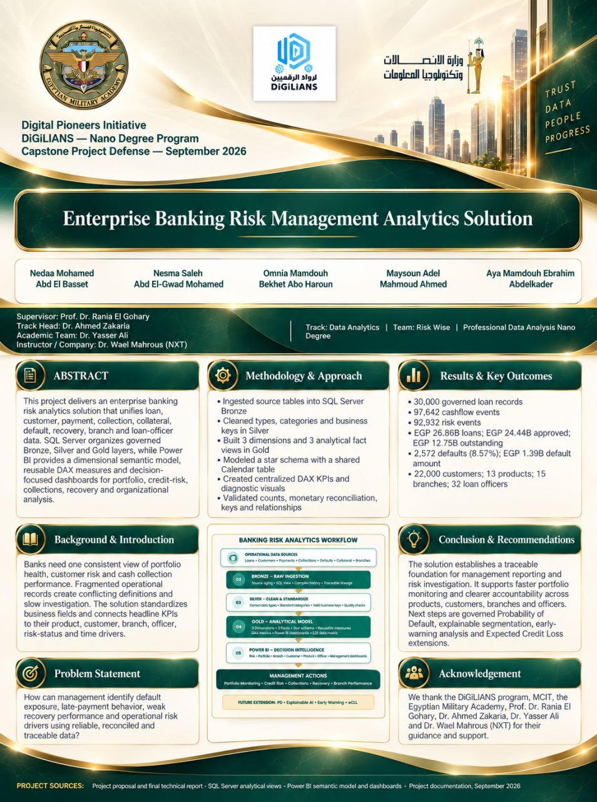
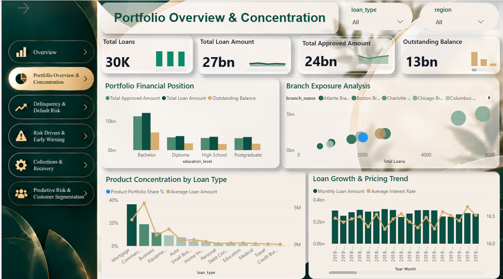
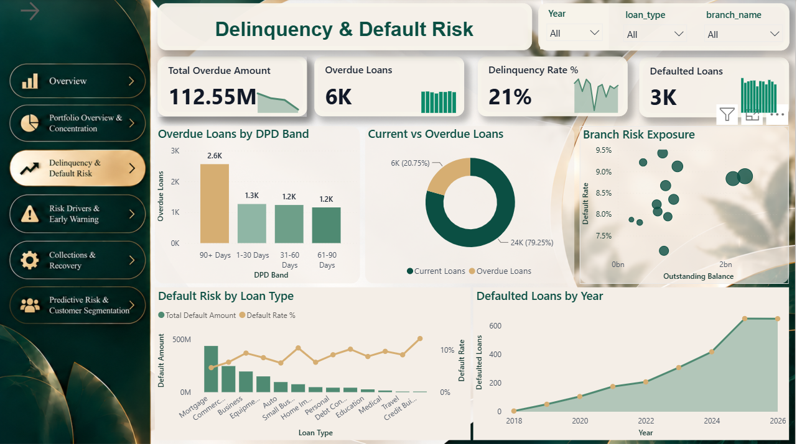
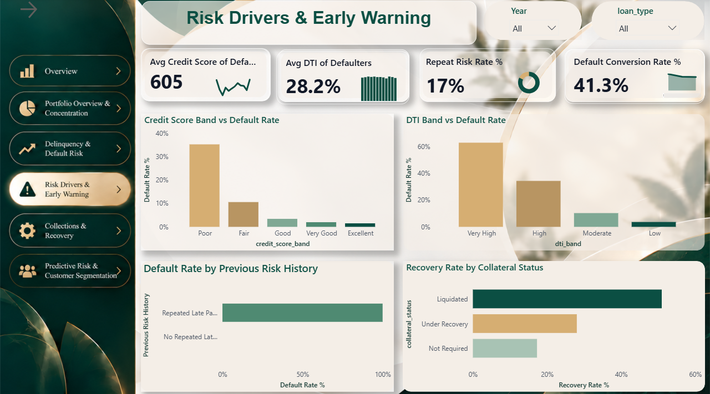
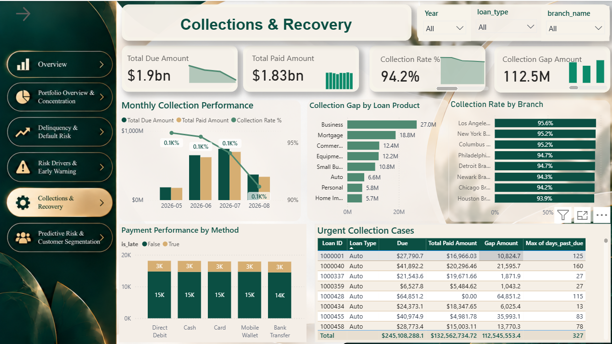
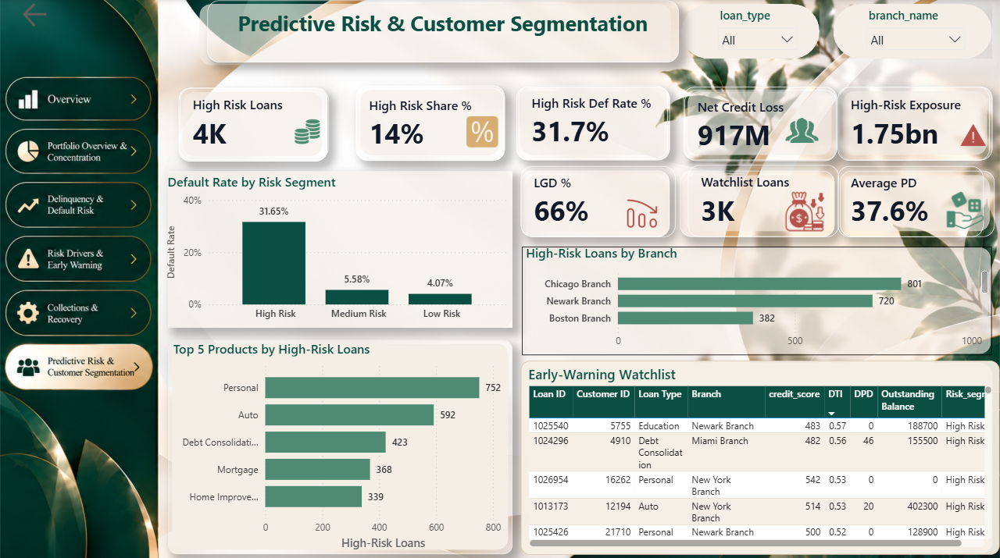
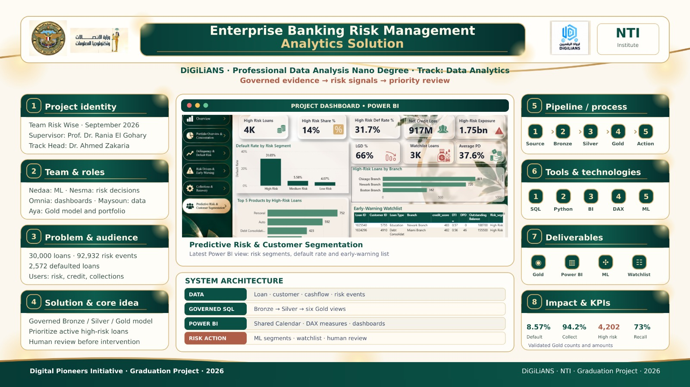

# Enterprise Banking Risk Management Analytics Solution

**Credit Risk Analytics · SQL Server · Power BI · Python · Machine Learning**

> **Capstone Project | Team Risk Wise | DiGiLiANS — Digital Pioneers Initiative | September 2026**

## Project Overview

Enterprise Banking Risk Management Analytics Solution is an end-to-end academic analytics project that transforms lending, customer, payment, collection, and credit-risk data into interactive management insights.

The project combines a **Bronze–Silver–Gold SQL data pipeline**, a **Power BI analytical model**, and a **machine-learning prototype** to help decision-makers monitor loan portfolios, investigate delinquency and default patterns, assess collections, and identify potentially high-risk loans.

**Core question:** How can a bank turn fragmented lending and repayment records into trustworthy insights and prioritized risk actions?

## Tools & Technologies

| Technology | Role in the project |
|---|---|
| SQL Server | Data ingestion, profiling, cleaning, transformation, validation, and analytical Gold views |
| Power BI | Dimensional data model, DAX KPIs, interactive dashboards, and drill-down analysis |
| Python | Data analysis and predictive modeling |
| Machine Learning | Logistic Regression, Decision Tree, Probability of Default (PD), and risk segmentation |

## Analytical Workflow

**Source Data → Bronze → Silver → Gold → Power BI Model → Dashboards → Predictive Risk Insights → Business Actions**

- **Bronze:** Ingest source records and preserve traceability.
- **Silver:** Clean data types, standardize business fields, and validate keys and records.
- **Gold:** Build reusable analytical views for customers, products, organizations, loans, cashflow, and risk events.
- **Power BI:** Connect dimensions and facts, define business KPIs, and analyze trends and risk drivers.
- **Predictive Analytics:** Compare default prediction approaches and use risk segments to support early review.

## Selected Project Results

| Metric | Project result |
|---|---:|
| Total Loans | 30,000 |
| Total Loan Amount | EGP 26.86B |
| Approved Loan Amount | EGP 24.44B |
| Outstanding Balance | EGP 12.75B |
| Delinquency Rate | 20.8% |
| Overdue Loans | ~6,000 |
| Overdue Amount | EGP 112.55M |
| Default Rate | 8.57% |
| Defaulted Loans | 2,572 |
| Default Amount | EGP 1.39B |
| High-Risk Loans | 4,202 |
| High-Risk Default Rate | 31.65% |

*Figures are from the project analysis. Individual dashboard screenshots may use different filters, time periods, rounding, and data views.*

## Interactive Power BI Dashboards

### 1. Portfolio Overview & Concentration

Explores portfolio size, approved and outstanding exposure, loan-product concentration, lending trends, and branch exposure.

### 2. Delinquency & Default Risk

Examines overdue loans and Days Past Due (DPD) bands, default trends, risk by loan type, and branch-level exposure.

### 3. Risk Drivers & Early Warning

Investigates credit-score bands, debt-to-income (DTI) levels, previous risk history, default patterns, and recovery-related indicators to support earlier investigation.

### 4. Collections & Recovery

Tracks due and paid amounts, collection rates and gaps, branch-level collection performance, payment methods, and urgent collection cases.

### 5. Predictive Risk & Customer Segmentation

Brings together estimated Probability of Default (PD), risk segments, high-risk exposure, and a loan watchlist to prioritize follow-up. Model output is intended for analytical decision support, not automated lending decisions.

## Project Infographic

## Project Files

- **[Power BI report — Bankwise.pbix](Bankwise.pbix)**
- **[Project poster](POSTER.png)**
- **[Project infographic](Infograph.jpeg)**
- **[Introductory video](video%20intro.mp4)**
- **[Capstone Report (PDF)](Banking%20Risk%20Capstone%20Report%20Public.pdf)**
- **[Presentation (PDF)](Enterprise_Banking_Risk_Management_Capstone_Presentation_Storytelling_Final.pdf)**

## Key Business Recommendations

1. **Prioritize high-risk exposures:** Combine predictive risk signals with outstanding exposure and repayment behavior.
2. **Track delinquency early:** Monitor DPD migration and repeated late payments before defaults occur.
3. **Target collection gaps:** Focus on products, branches, and loans with material unpaid balances.
4. **Investigate concentration:** Evaluate portfolio and default exposure across loan types and branches.
5. **Strengthen governance:** Validate KPIs, explain model outputs, and review risk-watchlist decisions with domain experts.

## Team Risk Wise

- Nedaa Mohamed Abd El Basset
- Nesma Saleh Abdelgwad Mohamed
- Omnia Mamdouh Bekhet Abo Haroun
- Maysoun Adel Mahmoud Ahmed
- Aya Mamdouh Ebrahim Abdelkader

**Program:** DiGiLiANS — Digital Pioneers Initiative  
**Track:** Professional Data Analysis  
**Capstone:** September 2026

## Scope & Limitations

This is an **academic analytics prototype using simulated/controlled data**, not a production banking system. Predictive-model results are for decision support. A production-ready IFRS 9 Expected Credit Loss (ECL) framework would require additional regulatory inputs, scenarios, validation, model governance, and controls.

